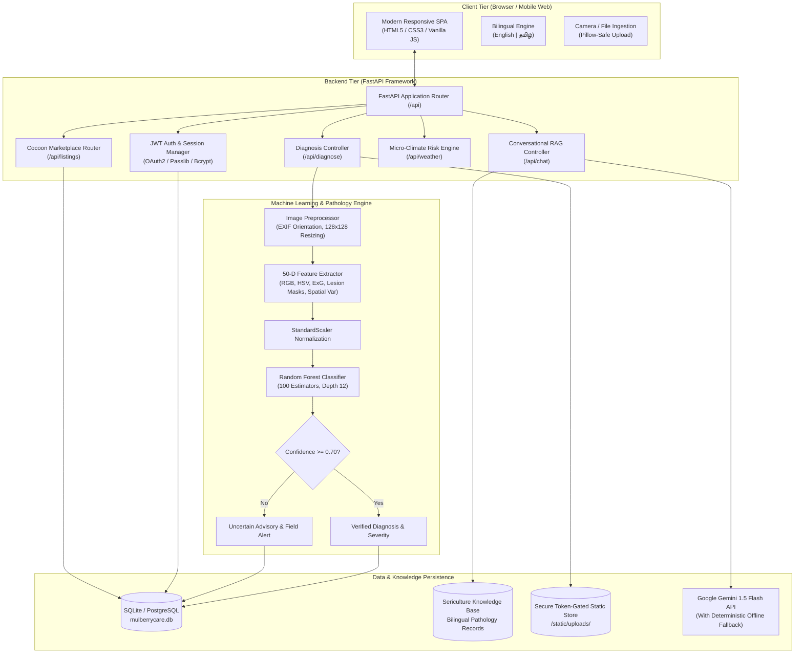
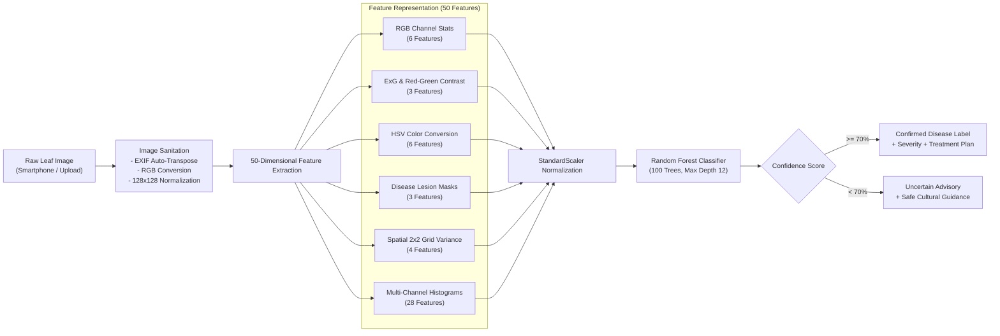
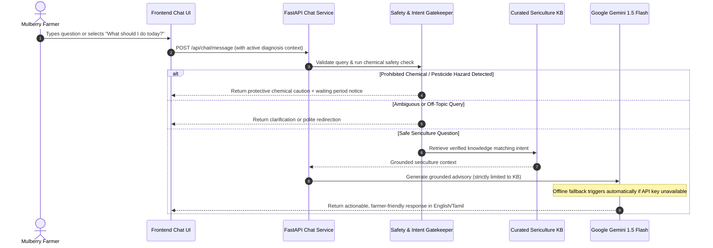

# 🌿 MulberryCare AI — Smart Sericulture Health & Decision Support Platform

[](https://www.python.org/)
[](https://fastapi.tiangolo.com/)
[](https://scikit-learn.org/)
[]()
[]()

**MulberryCare AI** is an end-to-end intelligent agricultural and sericulture decision support platform designed specifically for mulberry farmers and silkworm rearers. Mulberry (*Morus alba*) foliage serves as the exclusive nutrition source for silkworms (*Bombyx mori*); foliar disease outbreaks directly diminish cocoon harvests and silkworm vitality. 

MulberryCare AI empowers farmers with **instant vision-based leaf disease diagnosis**, **micro-climate weather risk alerts**, a **bilingual RAG agricultural advisory assistant**, and a **peer-to-peer cocoon marketplace** — accessible in both **English** and **Tamil (தமிழ்)**.

---

## 📑 Table of Contents
- [Key Features](#-key-features)
- [System Architecture](#-system-architecture)
- [Machine Learning Model & Pathology Pipeline](#-machine-learning-model--pathology-pipeline)
  - [Target Disease Classes](#target-disease-classes)
  - [Domain-Specific Feature Extraction (50-D)](#domain-specific-feature-extraction-50-d)
  - [Model Architecture & Training](#model-architecture--training)
  - [Confidence Guardrail & Fallback Safety](#confidence-guardrail--fallback-safety)
- [Conversational AI & Decision Support (Ask MulberryCare)](#-conversational-ai--decision-support-ask-mulberrycare)
- [Project Directory Structure](#-project-directory-structure)
- [Tech Stack](#-tech-stack)
- [Getting Started & Local Setup](#-getting-started--local-setup)
- [API Reference Overview](#-api-reference-overview)
- [Localization (English & Tamil)](#-localization-english--tamil)
- [Future Roadmap](#-future-roadmap)

---

## 🌟 Key Features

| Feature | Description |
| :--- | :--- |
| **🔬 Vision-Based Disease Diagnosis** | Upload or photograph mulberry leaves for instant diagnosis with confidence scoring and severity classification. |
| **🛡️ 70% Confidence Safety Guardrail** | Automatically flags uncertain images ($< 0.70$ confidence) to prevent incorrect fungicide application. |
| **🌦️ Weather & Microclimate Risk** | Calculates disease outbreak vulnerabilities (Leaf Rust, Leaf Spot, Powdery Mildew) based on ambient temperature and relative humidity. |
| **🤖 "Ask MulberryCare" RAG Chatbot** | Context-aware, multilingual assistant powered by Google Gemini (with offline fallback) strictly grounded in verified sericulture practices. |
| **⚠️ Chemical Safety & Dosage Guardrail** | Intercepts toxic/prohibited pesticide queries and enforces safe plucking intervals before leaves are fed to silkworms. |
| **📊 Farm Health Scorecard** | Dynamic 0–100 farm wellness index calculated from diagnosis history, crop conditions, and regional threat factors. |
| **🧺 Cocoon Marketplace** | Direct farmer-to-buyer listing and search platform for raw silk cocoons with variety, price, and location filters. |
| **🌐 Complete Bilingual Localization** | Seamless dual-language support in English and Tamil (தமிழ்) across all screens, advisories, and chat responses. |

---

## 🏗️ System Architecture



---

## 🧠 Machine Learning Model & Pathology Pipeline

The MulberryCare AI diagnostic system classifies foliar diseases using a high-efficiency machine learning pipeline serialized at `backend/app/ai/weights/mulberry_model.joblib`. 

Rather than relying on resource-intensive deep convolutional networks requiring dedicated GPU infrastructure, MulberryCare AI implements **domain-specific botanical feature engineering** combined with an **Ensemble Random Forest Classifier**, achieving high diagnostic accuracy and sub-millisecond execution times on commodity CPUs.



### Target Disease Classes

| Class | Scientific Agent | Visual Pathology & Impact |
| :--- | :--- | :--- |
| **Disease Free (Healthy)** | N/A | Bright green, succulent foliage with balanced chlorophyll and zero lesion spots. Ideal for young and late-age silkworm feeding. |
| **Leaf Rust** | *Cerotelium fici* | Small yellowish-brown to orange-red pustules on the lower leaf epidermis. Infected leaves desiccate, turn chlorotic, and fall prematurely. |
| **Leaf Spot** | *Cercospora moricola* | Dark-brown circular lesions developing grey/white necrotic centers. Severely diminishes leaf moisture and protein content. |

### Domain-Specific Feature Extraction (50-D)

Each leaf is transformed into a rich 50-dimensional feature vector in [`backend/app/ai/feature_extractor.py`](backend/app/ai/feature_extractor.py):

1. **RGB Color Statistics (6 Features):**
   - Mean and standard deviation for each channel: $(\mu_R, \sigma_R, \mu_G, \sigma_G, \mu_B, \sigma_B)$.
2. **Botanical Vegetation Indices (3 Features):**
   - **Excess Green Index (ExG):** $\text{ExG} = 2G - R - B$, quantifying healthy green leaf biomass.
   - **Red-to-Green Contrast Ratio:** $\frac{R + \epsilon}{G + \epsilon}$, directly targeting reddish-orange rust pustules.
3. **HSV Color Metrics (6 Features):**
   - Vectorized conversion from RGB to Hue ($H$), Saturation ($S$), and Value ($V$) with respective means and standard deviations $(\mu_H, \sigma_H, \mu_S, \sigma_S, \mu_V, \sigma_V)$.
4. **Pathology-Specific Lesion Pixel Ratios (3 Features):**
   - *Healthy foliage ratio:* $(0.20 \le H \le 0.45) \land (S > 0.15)$
   - *Rust pustule ratio:* $((H \le 0.18) \lor (H \ge 0.92)) \land (S > 0.25) \land (V > 0.20)$
   - *Necrotic spot ratio:* $(V < 0.38) \land (S < 0.60)$
5. **Spatial Grid Texture Variance (4 Features):**
   - $2 \times 2$ grid spatial standard deviations of Hue to quantify whether lesion distribution is localized or systemic.
6. **Multi-Channel Color Histograms (28 Features):**
   - 16-bin Hue histogram, 8-bin Saturation histogram, and 8-bin Value histogram capturing subtle color variations across the leaf surface.

### Model Architecture & Training

- **Pipeline:** `sklearn.pipeline.Pipeline([('scaler', StandardScaler()), ('classifier', RandomForestClassifier(...))])`
- **Hyperparameters:**
  - `n_estimators = 100`
  - `max_depth = 12`
  - `random_state = 42`
  - `stratify = y` (80% train / 20% test split)
- **Parallel Extraction:** Multi-threaded parallel processing with `ThreadPoolExecutor(max_workers=8)` in [`backend/app/ai/train_model.py`](backend/app/ai/train_model.py).

### Confidence Guardrail & Fallback Safety

```python
CONFIDENCE_THRESHOLD = 0.70  # Configurable via DISEASE_MODEL_CONFIDENCE_THRESHOLD
```
- When `confidence >= 0.70`: Outputs the confirmed classification, computes severity, and retrieves scientific advisory guidelines.
- When `confidence < 0.70`: Flags result as **"Uncertain / Low Confidence"**. The system suppresses pesticide instructions and prompts the user to capture a clearer image in natural lighting or contact an agricultural extension officer.

---

## 💬 Conversational AI & Decision Support (Ask MulberryCare)

The interactive assistant provides real-time sericulture guidance with context awareness:



### Safety Features:
- **Chemical Restriction Guardrail:** Intercepts pesticide inquiries and warns against spraying chemicals without adhering to mandatory plucking intervals (e.g., 10–15 days before feeding to silkworms).
- **Daily Farm Checklist Generator:** Assembles a personalized farm checklist combining recent leaf diagnoses, mulberry variety (S36, V1, M5), and current weather indicators.

---

## 📁 Project Directory Structure

```
Mulberry-AI/
├── .env.example                     # Environment configuration template
├── .gitignore                       # Clean repository ignore configuration
├── README.md                        # Project documentation (this file)
│
├── backend/                         # FastAPI Application Backend
│   ├── requirements.txt             # Python dependencies
│   ├── app/
│   │   ├── main.py                  # API server entrypoint & router assembly
│   │   ├── ai/                      # Machine learning subsystem
│   │   │   ├── feature_extractor.py # 50-D color, texture & lesion feature extraction
│   │   │   ├── inference.py         # Image inference engine with confidence scoring
│   │   │   ├── model_loader.py      # Weights loader & auto-training lifecycle
│   │   │   ├── train_model.py       # Parallel training pipeline for Random Forest
│   │   │   ├── preprocessing.py     # Image normalization utilities
│   │   │   └── chat_model.py        # Gemini API client & prompt orchestration
│   │   │   └── weights/
│   │   │       └── mulberry_model.joblib # Serialized model weights
│   │   ├── api/                     # REST API endpoints
│   │   │   ├── auth.py              # Farmer signup, login & JWT tokens
│   │   │   ├── diagnose.py          # Image upload, diagnosis & history API
│   │   │   ├── chat.py              # Conversational decision support API
│   │   │   ├── weather.py           # Weather risk calculation API
│   │   │   ├── listings.py          # Cocoon marketplace CRUD API
│   │   │   └── health.py            # API health check endpoint
│   │   ├── chat/                    # RAG chatbot service
│   │   │   ├── chat_service.py      # Chat orchestration & daily checklist generator
│   │   │   ├── intent.py            # Sericulture intent detector
│   │   │   ├── knowledge_base.py    # Curated bilingual agricultural knowledge
│   │   │   ├── retriever.py         # Multi-priority semantic context retriever
│   │   │   └── safety.py            # Chemical restriction & query filters
│   │   ├── database/                # Database layer
│   │   │   ├── db.py                # SQLAlchemy session & engine
│   │   │   └── seed_diseases.py     # Seed script for sericulture disease library
│   │   ├── models/                  # SQLAlchemy ORM entities
│   │   │   ├── user.py              # Farmer profiles & language preferences
│   │   │   ├── diagnosis.py         # Inspection logs & leaf image associations
│   │   │   ├── disease_info.py      # Disease pathology & treatment advisories
│   │   │   └── listing.py           # Cocoon marketplace inventory
│   │   ├── schemas/                 # Pydantic validation schemas
│   │   └── services/                # Business logic services
│   │       ├── auth_service.py      # Password hashing & JWT cryptography
│   │       └── weather_service.py   # Meteorological risk calculations
│   └── static/                      # Static assets & token-secured uploads
│
├── frontend/                        # Browser-based Client UI
│   ├── index.html                   # Main single-page web application
│   ├── logo.png                     # MulberryCare branding asset
│   ├── css/
│   │   └── style.css                # Responsive styling, design system & animations
│   └── js/
│       └── app.js                   # Application state, API integration & localization
│
└── Mulberry leaf dataset/           # Local leaf dataset (git-ignored for clean repo)
    └── Mulberry Data/
        ├── Disease Free leaves/     # Healthy leaf images
        ├── Leaf Rust/               # Leaf Rust (Cerotelium fici) images
        └── Leaf spot/               # Leaf Spot (Cercospora moricola) images
```

---

## 🛠️ Tech Stack

| Layer | Technologies |
| :--- | :--- |
| **Backend** | Python 3.10+, FastAPI, Uvicorn, Pydantic v2, SQLAlchemy 2.0 |
| **Machine Learning** | Scikit-Learn (Random Forest), NumPy, Pillow, Joblib |
| **Large Language Models** | Google Gemini API (`gemini-1.5-flash`) with structured RAG fallback |
| **Frontend** | HTML5, Modern CSS3 (CSS Variables, Flexbox/Grid), Vanilla JavaScript (ES6+) |
| **Database** | SQLite (development/local) / PostgreSQL ready |
| **Security** | JWT (JSON Web Tokens), OAuth2 password flow, Bcrypt encryption |

---

## 🚀 Getting Started & Local Setup

### Prerequisites
- Python 3.10 or higher
- Git installed on your machine
- Modern web browser (Chrome, Edge, Firefox, Safari)

### 1. Clone the Repository
```bash
git clone https://github.com/devs27/Mulberry_AI.git
cd Mulberry_AI
```

### 2. Backend Setup
```bash
cd backend

# Create and activate virtual environment
python -m venv venv
# On Windows:
venv\Scripts\activate
# On Linux/macOS:
source venv/bin/activate

# Install dependencies
pip install -r requirements.txt
```

### 3. Environment Configuration
Create a `.env` file inside the `backend/` folder (or copy from `.env.example`):
```ini
# Core Configuration
SECRET_KEY=your_secure_random_secret_key_here
ALGORITHM=HS256
ACCESS_TOKEN_EXPIRE_MINUTES=1440

# AI Configuration
AI_MODE=auto
DISEASE_MODEL_CONFIDENCE_THRESHOLD=0.70

# Optional: Google Gemini API for Conversational Assistant
# (If omitted, the chatbot operates in verified offline fallback mode)
GEMINI_API_KEY=your_gemini_api_key_here
GEMINI_MODEL=gemini-1.5-flash
```

### 4. Train the ML Model (Optional)
The trained model is pre-included at `backend/app/ai/weights/mulberry_model.joblib`. If you wish to retrain it using your local dataset:
```bash
python -m app.ai.train_model
```

### 5. Start the Backend Server
```bash
uvicorn app.main:app --reload --port 8000
```
- The backend API will be live at `http://127.0.0.1:8000`
- Interactive OpenAPI documentation is accessible at `http://127.0.0.1:8000/docs`

### 6. Launch the Frontend
Simply open `frontend/index.html` in your web browser:
- You can double-click `frontend/index.html`, or serve it with any lightweight HTTP server:
```bash
cd frontend
python -m http.server 3000
```
Visit `http://localhost:3000` in your browser.

---

## 📡 API Reference Overview

| Endpoint | Method | Authentication | Description |
| :--- | :---: | :---: | :--- |
| `/api/health` | `GET` | Public | System status and connectivity check. |
| `/api/auth/register` | `POST` | Public | Register a farmer profile with preferred mulberry variety. |
| `/api/auth/login` | `POST` | Public | Authenticate and receive JWT access token. |
| `/api/auth/me` | `GET` | Bearer Token | Retrieve authenticated farmer details. |
| `/api/diagnose/upload` | `POST` | Bearer Token | Upload a leaf image for disease diagnosis and advisory. |
| `/api/diagnose/history` | `GET` | Bearer Token | Retrieve chronological diagnosis history for the user. |
| `/api/weather/risk` | `GET` | Bearer Token | Retrieve microclimate disease susceptibility indices. |
| `/api/chat/message` | `POST` | Bearer Token | Send questions to the "Ask MulberryCare" decision assistant. |
| `/api/listings/create` | `POST` | Bearer Token | Post a new cocoon harvest listing in the marketplace. |
| `/api/listings/search` | `GET` | Bearer Token | Query active cocoon listings with variety/village filters. |
| `/api/listings/{id}/sold` | `POST` | Bearer Token | Mark a farmer's cocoon listing as sold. |

---

## 🌐 Localization (English & Tamil)

Sericulture in India is concentrated across major silk-producing states including Tamil Nadu, Karnataka, Andhra Pradesh, and West Bengal. To ensure usability by grassroots farmers, MulberryCare AI is natively localized:
- **Instant Toggle:** Switch languages dynamically at any time without page reloads.
- **Agricultural Terminology:** Uses field-tested terminology familiar to local sericulture extension workers (e.g., *கவாத்து* for pruning, *சௌக்கி* for chawki rearing, *துக்ரா* for mealybug damage).
- **Dual-Language Advisories:** All diagnostic advisories and chemical safety notices are delivered in both languages simultaneously.

---

## 🗺️ Future Roadmap

- [ ] **Mobile Application:** Progressive Web App (PWA) / Android APK for offline-first rural field inspections.
- [ ] **Silkworm Disease Detection:** Expanding computer vision models to detect silkworm larval diseases (*Grasserie*, *Flacherie*, *Muscardine*).
- [ ] **Automated Leaf Area Damage Segmentation:** Deep learning segmentation (U-Net) to calculate precise leaf lesion area percentage.
- [ ] **IoT Sensor Integration:** Real-time sensor telemetry for rearing room temperature and humidity automation.
- [ ] **Government Sericulture Scheme Linkage:** Integrated alerts for state government subsidies and market auction prices.

---

## 📄 License
This project is open-source and available under the [MIT License](LICENSE).
